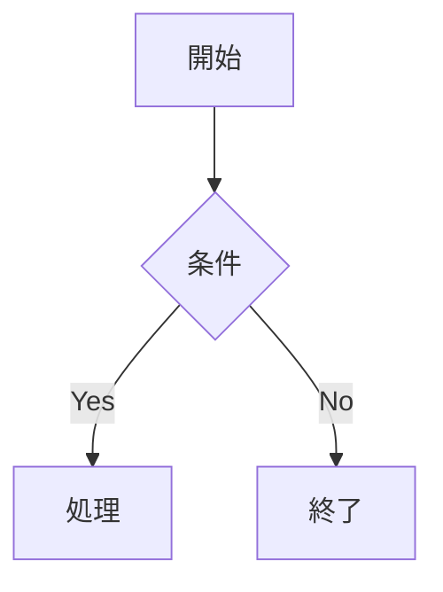

# Markdown Editor V3

macOS 用の軽量な GitHub Flavored Markdown エディタです。
左にソースエディタ、右にライブプレビュー (KaTeX + mermaid 対応) の 2 ペイン構成。

**V3 では pandoc / TeX Live への依存を完全に除去し、外部ツール不要で PDF・HTML エクスポートが可能です。**
さらに本リビジョンでプレビュー描画を再設計し、編集中の RAM 消費とピークメモリを抑えました。

---

## 主な機能

- **GitHub Flavored Markdown** (表 / タスクリスト / 取り消し線 / コードブロック)
- **数式レンダリング**: `$y = x^2$` / `$$e = mc^2$$` を KaTeX で即時プレビュー
- **化学式 (mhchem)**: `$\ce{H2O}$` / `$\ce{NaOH + HCl -> NaCl + H2O}$`
- **mermaid 図**: ` ```mermaid ` フェンス内のフローチャート・シーケンス図などを描画
- **ライブプレビュー**: 入力に追従して即時更新 (HSplitView でペイン幅変更可)
- **PDF 書き出し**: ⌘⇧E で PDF として書き出し (外部ツール不要)
- **HTML 書き出し**: ⌘⇧H で自己完結 HTML を書き出し (KaTeX + mermaid 付き)
- **オフライン対応**: KaTeX・mermaid のアセットをアプリにバンドル同梱
- **ドキュメントベース**: ⌘N / ⌘O / ⌘S / 別名で保存
- **.md / .markdown / .mdown / .mkd 拡張子**を関連付け

## パフォーマンス最適化 (本リビジョン)

プレビューは WKWebView 上で動作します。従来は編集のたびにページ全体を再ロードし、
3.2 MB の `mermaid.min.js` や KaTeX を毎回パースし直していたため、メモリが常時上下していました。
本リビジョンで以下を改善しています。

| 項目 | 変更前 | 変更後 |
|------|--------|--------|
| プレビュー更新 | 毎回ページ全体を再ロード | 初回のみ全ロード、以降は本文 DOM だけを差し替え |
| 重いスクリプト | 常に KaTeX + mermaid を読み込み | 数式 / mermaid を含む文書でのみ読み込み |
| 未使用依存 | MarkdownUI (+ NetworkImage) をリンク | 削除し swift-markdown のみに整理 |
| デッドコード | 未使用の AttributedRenderer を同梱 | 削除 |

機能・出力結果は変わりません。

## V2 → V3 の主な変更点

| 項目 | V2 | V3 |
|------|------|------|
| PDF 書き出し | pandoc + xelatex (外部ツール必須) | WKWebView (外部ツール不要) |
| HTML 書き出し | なし | ⌘⇧H で対応 |
| 数式 / mermaid | CDN 必須 | バンドル同梱 (オフライン対応) |
| App Sandbox | 無効 | 有効 (セキュリティ強化) |
| TeX Live | 必須 (4〜7 GB) | 不要 |

## 動作環境

- macOS 13.0 (Ventura) 以降
- ユニバーサルバイナリ (Intel + Apple Silicon)

## インストール

1. DMG を開く
2. `MarkdownEditor.app` を `Applications` フォルダにドラッグ
3. 初回起動時に Gatekeeper の警告が出る場合があります
   → `Applications` の MarkdownEditor を **右クリック → 開く** で許可

## 使い方

1. アプリを起動 → 空のドキュメントウィンドウが開きます
2. **左ペイン (ソース)** に Markdown を入力
3. **右ペイン (プレビュー)** に即座にレンダリング結果が表示されます
4. `⌘S` でファイル保存
5. `⌘⇧E` で PDF として書き出し
6. `⌘⇧H` で HTML として書き出し

### キーボードショートカット

| ショートカット | 動作 |
|----------------|------|
| `⌘N` | 新規ドキュメント |
| `⌘O` | 開く |
| `⌘S` | 保存 |
| `⌘⇧S` | 別名で保存 |
| `⌘⇧E` | PDF として書き出す |
| `⌘⇧H` | HTML として書き出す |
| `⌘Q` | アプリ終了 |

### 数式の書き方

```markdown
インライン数式: $y = x^2$, $\alpha + \beta$
ブロック数式:
$$
\int_{-\infty}^{\infty} e^{-x^2}\,dx = \sqrt{\pi}
$$
化学式: $\ce{NaOH + HCl -> NaCl + H2O}$
```

### mermaid 図

````markdown

````


## アーキテクチャ概要

| ファイル | 役割 |
|----------|------|
| `MarkdownEditorApp.swift` | アプリ本体 (DocumentGroup) とメニューコマンド |
| `ContentView.swift` | 2 ペイン構成・ツールバー・エクスポート起動 |
| `MarkdownTextView.swift` / `SourceEditor.swift` | NSTextView ベースのソースエディタ |
| `EditorBridge.swift` | ツールバーから NSTextView への編集操作の橋渡し |
| `MarkdownToolbar.swift` | 記法挿入ボタンと表挿入シート |
| `HTMLRenderer.swift` | swift-markdown の AST → HTML 本文への変換 |
| `PreviewView.swift` | WKWebView プレビュー (差分更新・条件付きスクリプト読込) と HTML 生成 |
| `PDFExporter.swift` / `HTMLExporter.swift` | PDF / HTML エクスポート |
| `FrontMatter.swift` | 先頭 YAML フロントマターの除去 |
| `MarkdownDocument.swift` | FileDocument 実装 |

> プレビューは初回のみ骨組み HTML を `loadHTMLString` で読み込み、以降は
> `applyMarkdown(html)` で本文 DOM のみを差し替えます。新たに数式 / mermaid が
> 必要になった場合だけ一度再ロードします。

## ビルド方法

```sh
xcodebuild -project MarkdownEditor.xcodeproj \
           -scheme MarkdownEditor \
           -configuration Release \
           build
```

生成された `MarkdownEditor.app` をそのまま起動できます。

## 使用しているライブラリ・ツール

- [swift-markdown](https://github.com/swiftlang/swift-markdown) — cmark-gfm ベースのパーサ (Markdown → HTML 変換に使用)
- [KaTeX](https://katex.org) — 数式レンダリング (バンドル同梱)
- [mermaid](https://mermaid.js.org) — 図表 (バンドル同梱)