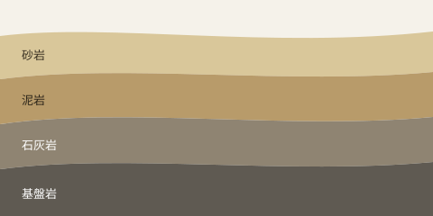
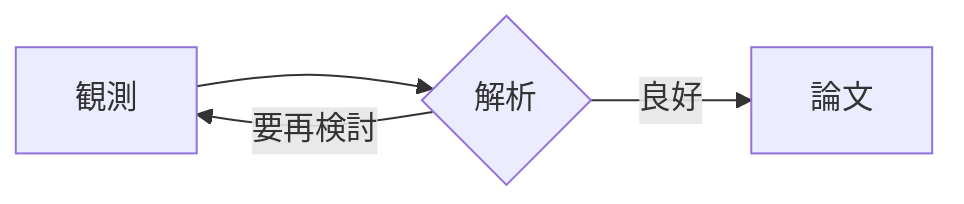

[[toc]]

## 基本の書式

**太字**、*斜体*、~~取り消し線~~、==マーカー==、++追加++、`インラインコード`、H~2~O、x^2^、:smile: の絵文字。

段落の中の改行は、環境設定で「そのまま改行」にできます。
この行はひとつ前の行の続きです。

- 箇条書き
  - 入れ子
    - さらに入れ子
- [リンク](https://example.com) と自動リンク https://example.com

1. 番号付き
2. 番号付き

- [x] 完了したタスク（閲覧モードでもクリックで切り替えられます）
- [ ] 未完了のタスク
- [/] 進行中のタスク

> 引用です。
>
> > 引用の中の引用

---

## 数式

文中の数式 $a_1 + b_1 = c_{n+1}$ と $E = mc^2$、ブロックの数式:

$$
\int_{-\infty}^{\infty} e^{-x^2}\,dx = \sqrt{\pi}
$$

式番号付き:

$$
\nabla \cdot \mathbf{E} = \frac{\rho}{\varepsilon_0} \tag{1}
$$

化学式 $\ce{CaCO3 + 2HCl -> CaCl2 + H2O + CO2}$、行列:

$$
A = \begin{pmatrix} a_{11} & a_{12} \\ a_{21} & a_{22} \end{pmatrix}
$$

`\(x_1\)` と `\[x^2\]` の形式にも対応します: \(x_1 + y_1\)

```math
\sum_{k=1}^{n} k = \frac{n(n+1)}{2}
```

## 図と表

相対パスの画像は、説明文が図のキャプションになります。




Obsidian の埋め込み記法: ![[mark.png|64]]

| 試料 | SiO~2~ (wt%) | 備考 |
|:-----|-------------:|:----:|
| A-1 | 51.2 | 玄武岩 |
| A-2 | 63.8 | 安山岩 |
| A-3 | 72.4 | 流紋岩 |

: 全岩組成の例



## コード

```python
def fibonacci(n: int) -> int:
    """フィボナッチ数を返す"""
    return n if n < 2 else fibonacci(n - 1) + fibonacci(n - 2)
```

```swift:App.swift
@main struct App { static func main() { print("こんにちは") } }
```

```diff
- 古い行
+ 新しい行
```

## 脚注と定義

本文に脚注を付けられます[^note]。略語も使えます: HTML。

[^note]: これは脚注です。

*[HTML]: HyperText Markup Language

用語
: 用語の定義です。

## 注記

> [!NOTE]
> GitHub の記法です。

> [!WARNING] 独自のタイトル
> タイトルも付けられます。

> [!tip]- 折りたたみ（Obsidian）
> クリックで開きます。

!!! danger "MkDocs の記法"
    こちらも表示できます。

:::note warn
Qiita / Zenn の記法です。
:::

:::details 詳細を開く
Zenn の折りたたみです。
:::

## ルビと傍点

｜青空《あおぞら》の下、吾輩《わがはい》は《《ここ》》にいる。{東京|とうきょう}と{漢字|かん|じ}。

## リンク

- [同じ文書の見出しへ](#数式)
- [別のファイルへ](読書サンプル.md)
- [[読書サンプル|Wiki リンク]]
- #タグ もピル状に表示します

%%このコメントは閲覧モードでは表示されません%%

<details>
<summary>HTML の details</summary>

<kbd>⌘</kbd> + <kbd>E</kbd> で閲覧と編集を切り替えます。

</details>
