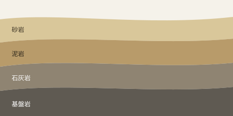

# 一

吾輩《わがはい》は猫である。名前はまだ無い。

どこで生れたかとんと見当《けんとう》がつかぬ。何でも薄暗いじめじめした所でニャーニャー泣いていた事だけは記憶している。吾輩はここで始めて人間というものを見た。しかもあとで聞くとそれは書生という人間中で一番｜獰悪《どうあく》な種族であったそうだ。この書生というのは時々我々を捕《つかま》えて煮《に》て食うという話である。しかしその当時は何という考もなかったから別段恐しいとも思わなかった。ただ彼の掌《てのひら》に載せられてスーと持ち上げられた時何だかフワフワした感じがあったばかりである。掌の上で少し落ちついて書生の顔を見たのがいわゆる人間というものの見始《みはじめ》であろう。この時妙なものだと思った感じが今でも残っている。第一毛をもって装飾されべきはずの顔がつるつるしてまるで薬缶《やかん》だ。その後《ご》猫にもだいぶ逢《あ》ったがこんな片輪《かたわ》には一度も出会《でく》わした事がない。のみならず顔の真中があまりに突起している。そうしてその穴の中から時々ぷうぷうと煙《けむり》を吹く。どうも咽《む》せぽくて実に弱った。これが人間の飲む煙草《たばこ》というものである事はようやくこの頃知った。

この書生の掌の裏《うち》でしばらくはよい心持に坐っておったが、しばらくすると非常な速力で運転し始めた。書生が動くのか自分だけが動くのか分らないが無暗《むやみ》に眼が廻る。胸が悪くなる。到底｜助《たす》からないと思っていると、どさりと音がして眼から火が出た。それまでは記憶しているがあとは何の事やらいくら考え出そうとしても分らない。

ふと気が付いて見ると書生はいない。たくさんおった兄弟が一｜疋《ぴき》も見えぬ。肝心《かんじん》の母親さえ姿を隠してしまった。その上今までの所とは違って無暗に明るい。眼を明いていられぬくらいだ。はてな何でも容子《ようす》がおかしいと、のそのそ這《は》い出して見ると非常に痛い。吾輩は藁《わら》の上から急に笹原の中へ棄てられたのである。

---

# 縦書きの確認

ここからは組版を確かめるための文章です。西暦2026年11月7日、気温は15度でした。Markdown や CSS といった欧文、ABC のような略語が混ざっても読めるようにします。本当に!? 驚きました!! 数式 $a_1 + b_1$ は正立し、{東京|とうきょう}のようなルビも右側に付きます。《《傍点》》も同様です。

> 引用は上から字下げします。長い引用が複数の行にわたっても、行の頭がきちんと揃うようにしたいところです。

- 箇条書きの一つ目
- 箇条書きの二つ目

| 項目 | 値 |
|---|---|
| 表 | 横組みのまま |
| 図 | 横組みのまま |

```python
print("コードも横組みのまま")
```

$$
\sum_{k=1}^{n} k^2 = \frac{n(n+1)(2n+1)}{6}
$$



本文へ戻ります。読み進めると左へスクロールし、ホイールの上下でも左右へ動きます。スペースキーや左右の矢印キーで一画面ずつ送れます。

[記法ガイドへ戻る](記法ガイド.md)
